# StandBy — лаунчер-настольные часы для Android + компаньон для macOS

Лёгкий лаунчер для старого Android-телефона (Android 6.0+), который превращает его в настольные часы
в духе режима StandBy на iPhone: часы, календарь, погода, нагрузка Mac, плеер и пульт для созвонов.
Компаньон для macOS живёт в строке меню и передаёт на телефон данные с Mac по USB или по Wi-Fi через adb.

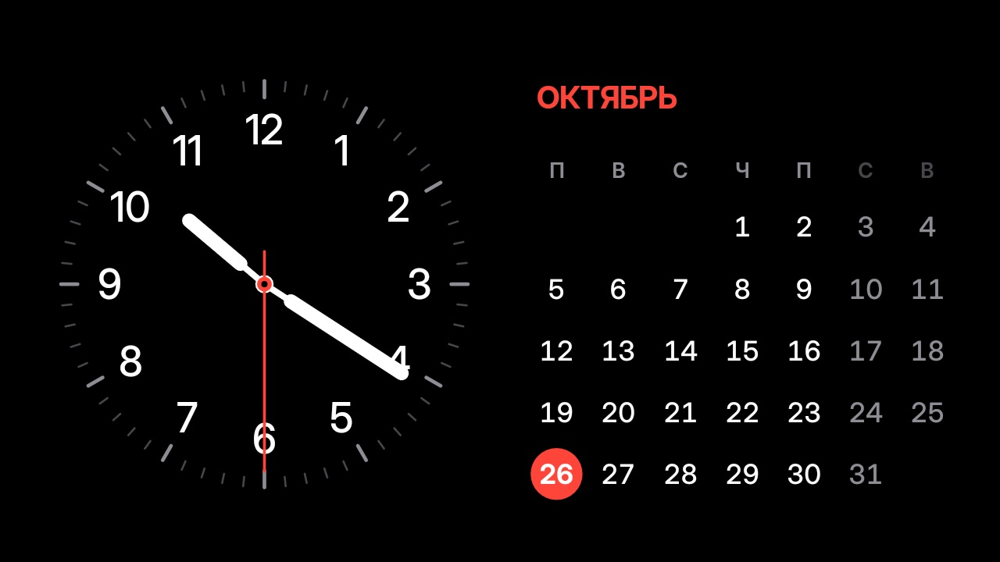

| | |
|---|---|
| 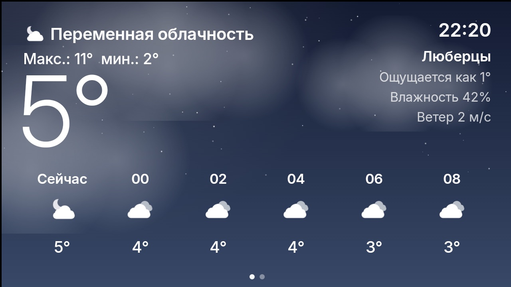 | 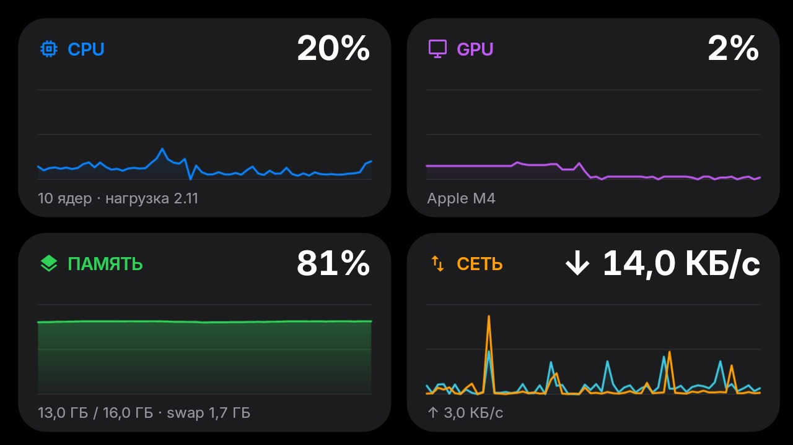 |
| 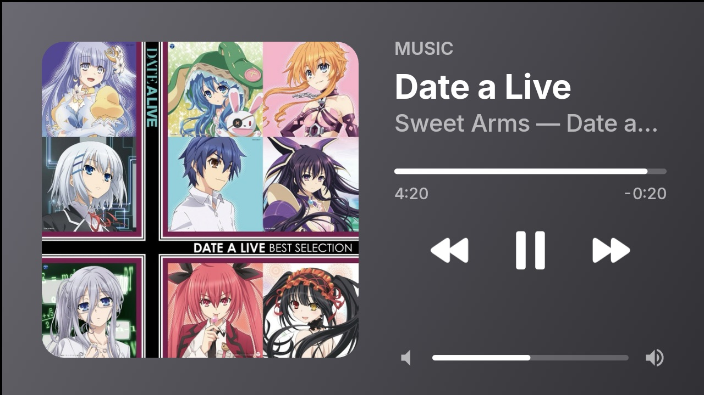 | 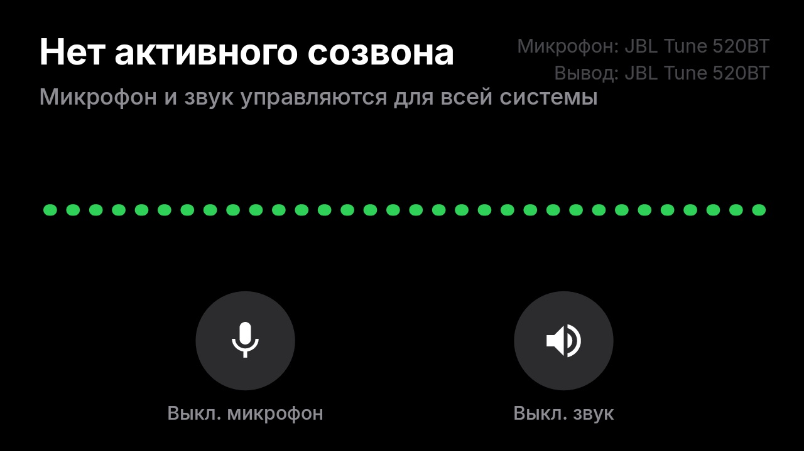 |
|  |  |

## Содержание
- [Что внутри](#что-внутри)
- [Быстрый старт](#быстрый-старт)
- [Лаунчер: карточки](#лаунчер-карточки)
- [Лаунчер: приложения и настройки](#лаунчер-приложения-и-настройки)
- [Оформление и свои темы](#оформление-и-свои-темы)
- [Компаньон для macOS](#компаньон-для-macos)
- [Подключение по Wi-Fi](#подключение-по-wi-fi)
- [Как всё устроено](#как-всё-устроено)
- [Протокол лаунчер ⇄ компаньон](#протокол-лаунчер--компаньон)
- [Сборка из исходников](#сборка-из-исходников)
- [Решение проблем](#решение-проблем)
- [Ограничения](#ограничения)
- [Лицензии](#лицензии)

## Что внутри

```
standby/
├── android/                 лаунчер: Kotlin, только framework API (без AndroidX), minSdk 23
│   ├── app/src/main/java/dev/standby/
│   │   ├── MainActivity.kt  окно, жесты, ночной режим, удержание экрана, WifiLock
│   │   ├── cards/           карточки (часы, календарь, погода, Mac-карточки) и отрисовка
│   │   ├── ui/              навигация, пейджер, темы, iOS-контролы, иконки погоды
│   │   ├── settings/        раздел настроек в стиле iPad
│   │   ├── apps/            список приложений
│   │   └── data/            настройки, погода, HTTP, сервер для компаньона, логи
│   └── keystore/            ключ подписи (личное использование)
├── companion/               компаньон: Swift (AppKit + SwiftUI), Swift Package, macOS 13+
│   ├── Sources/StandByCompanion/  (TouchBar.swift — эмулятор Touch Bar)
│   └── build.sh             сборка .app и zip
├── themes/sunset.json       пример своей темы
├── docs/screenshots/        скриншоты для этого README
├── docs/touchbar/           исследование и адаптация эмулятора Touch Bar
├── dist/
│   ├── StandBy.apk                     готовый лаунчер (release, ~450 КБ)
│   └── StandBy-Companion-macOS.zip     готовый компаньон (Apple Silicon)
├── AGENTS.md                инструкция для ИИ-агентов, которые дорабатывают проект
└── REPORT.md                отчёт о проделанной работе
```

## Быстрый старт

**Телефон**
1. Включите «Отладку по USB»: Настройки → О телефоне → 7 раз нажать на «Номер сборки», затем
   Для разработчиков → Отладка по USB.
2. Подключите телефон к Mac и установите лаунчер:
   ```bash
   adb install -r dist/StandBy.apk
   ```
   Без adb: скопируйте `StandBy.apk` на телефон и откройте его, разрешив установку из неизвестных источников.
3. Нажмите «Домой» и выберите **StandBy → Всегда**. То же самое: свайп вправо → Об устройстве →
   «Выбрать лаунчер по умолчанию».
4. Свайп вправо → Погода → Город: найдите свой город.

**Mac**
1. Установите adb, если его ещё нет: `brew install android-platform-tools`.
   adb из Android Studio (`~/Library/Android/sdk/platform-tools/adb`) тоже подойдёт, компаньон найдёт его сам.
2. Распакуйте `dist/StandBy-Companion-macOS.zip` и перенесите **StandBy Companion.app** в «Программы».
3. При первом запуске откройте приложение через правый клик → «Открыть»: оно подписано ad-hoc. Если macOS всё равно
   не пускает: Системные настройки → Конфиденциальность и безопасность → «Всё равно открыть».
4. В строке меню появится иконка телефона: перечёркнутая — нет подключения, обычная — подключено.
5. При первом использовании macOS спросит разрешения:
   - **Автоматизация → Music / Spotify** — для плеера;
   - **Микрофон** — для визуализатора, пока на телефоне открыта карточка «Созвоны»;
   - **Универсальный доступ** — для нажатий на карточке Touch Bar;
   - **Локальная сеть** — для подключения по Wi-Fi.

## Лаунчер: карточки

Экран работает только в горизонтальной ориентации и не гаснет, пока лаунчер открыт.

| Жест | Действие |
|---|---|
| Свайп вверх / вниз | следующая / предыдущая карточка (по кругу) |
| Свайп влево | список приложений (свайп вправо — назад) |
| Свайп вправо | настройки (свайп влево — назад) |
| Долгое нажатие на карточку | настройки этой карточки |
| Кнопка «Домой» | к карточкам; повторное нажатие — к первой карточке |

Справа во время переключения появляются точки-индикатор, как в StandBy. Порядок и видимость карточек
меняются в Настройках → Карточки.

### Главная — часы и календарь
Экран делится пополам: часы и календарь на месяц. Нажатие на часы переключает аналоговые и цифровые;
часы можно перенести вправо. Сегодняшний день выделен акцентным цветом, выходные приглушены.


### Погода
Текущая температура, состояние, макс./мин., «ощущается как», влажность, ветер и город.
Внизу прогноз на 12 часов с шагом 2 часа. Нажатие на карточку переключает недельный прогноз.
Фон — анимированное небо по погоде и времени суток: солнце, звёзды, облака, дождь, снег, вспышки грозы.
Единицы: °C, °F, K; ветер в м/с, км/ч, mph. Данные — [Open-Meteo](https://open-meteo.com), обновление каждые 30 минут.

| По часам | На неделю |
|---|---|
|  | 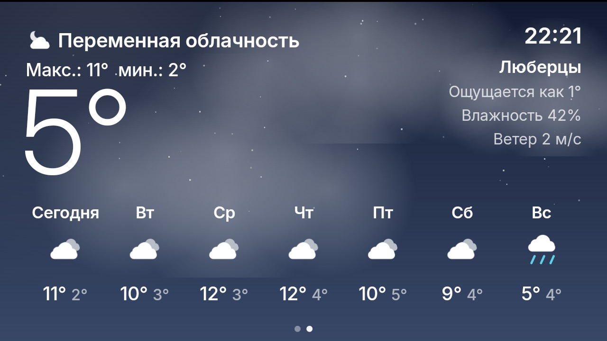 |

### Календарь
Месяц с переключением ‹ ›, нажатие на заголовок или «Сегодня» возвращает к текущему месяцу.
Слева крупно выбранная дата (нажмите на любой день), номер недели и день года.
Первый день недели и номера недель настраиваются.

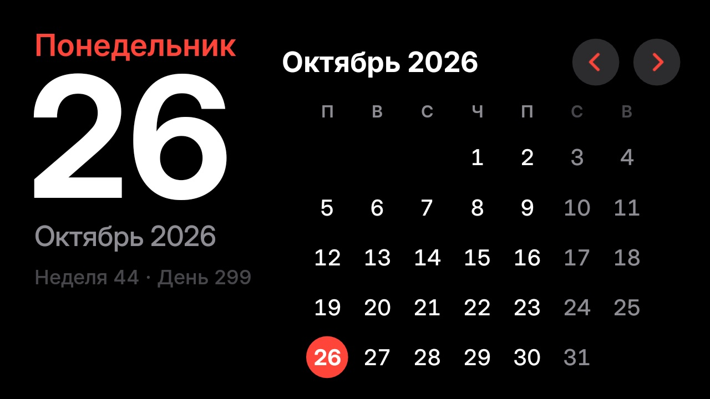

### Часы
Четыре полноэкранных циферблата, переключаются нажатием на карточку. Цвет циферблата выбирается
из палитры, формат 12/24 ч, секунды и дата отключаются.

| Крупные | Циферблат |
|---|---|
| 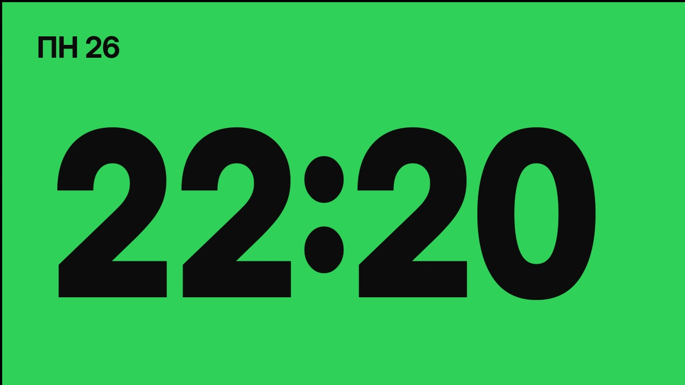 | 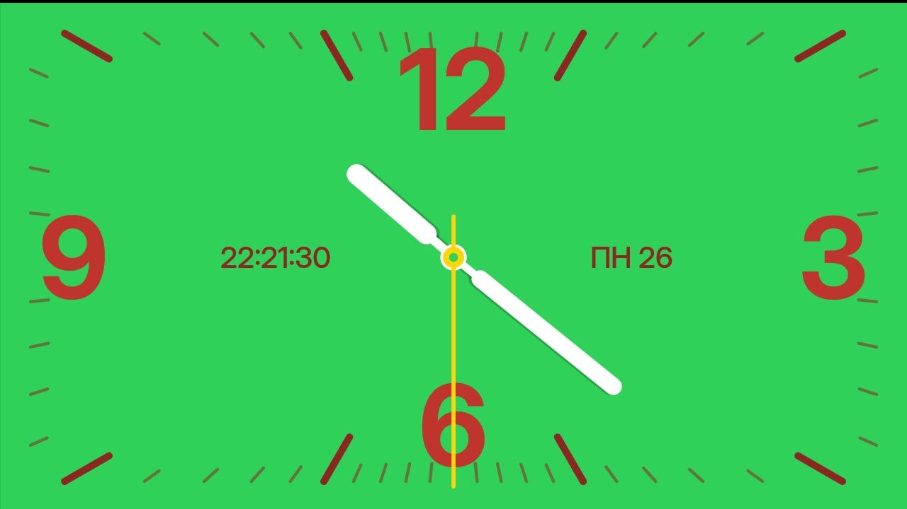 |
| **Классика** | **Тонкие** |
| 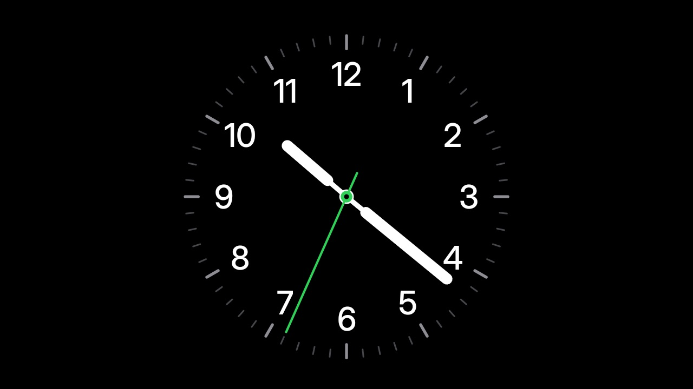 | 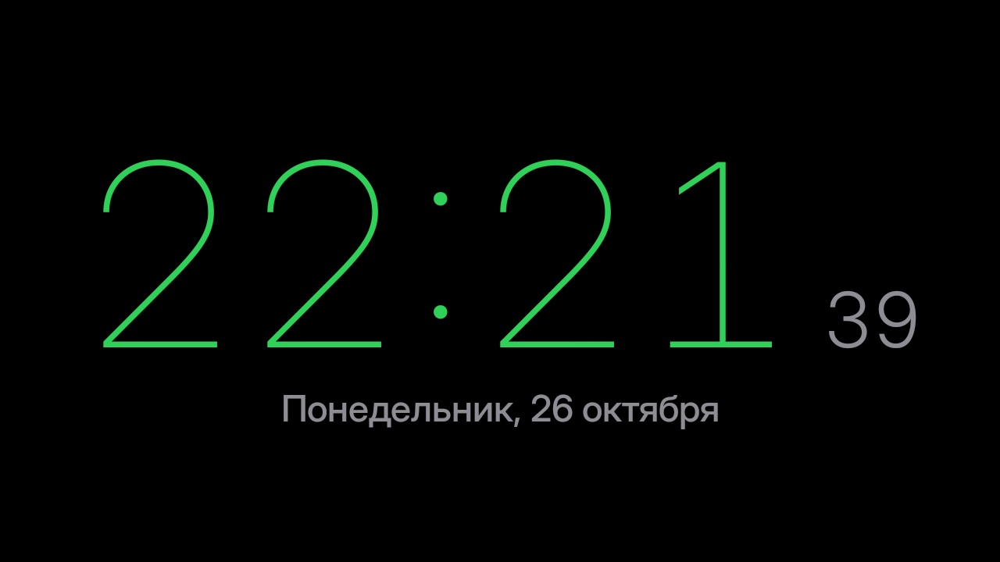 |

### Нагрузка Mac \*
Четыре плитки с графиками: CPU (число ядер, load average), GPU (модель), память (занято / всего, swap),
сеть (приём и отдача, заряд батареи). Обновление раз в секунду, длина истории — 1, 2 или 5 минут.


### Плеер \*
Трек из Apple Music или Spotify: обложка, название, исполнитель, альбом, прогресс.
Работают пауза, предыдущий и следующий трек, перемотка (тяните полосу прогресса) и системная громкость Mac.
Фон подкрашивается цветом обложки.


### Созвоны \*
Компаньон определяет созвон по приложению, которое использует микрофон (Zoom, Meet, Teams, Telegram, FaceTime…),
и показывает его название и длительность. Две кнопки выключают микрофон и звук для всей системы Mac.
Аудиовизуализатор показывает уровень микрофона: столбики или волна.


### Touch Bar \*
Настоящий Touch Bar macOS: кнопки активного приложения и Control Strip, отрисованные самой системой.
Это тот же механизм, что у симулятора Touch Bar в Xcode и у проекта
[touch-bar-simulator](https://github.com/sindresorhus/touch-bar-simulator); работает и на Mac без Touch Bar.
Полоса 36:1 раскладывается в 2–4 строки по промежуткам между группами кнопок: группа никогда не разрывается,
первая строка прижата влево (`esc`), последняя вправо (Control Strip). Тап, удержание, перетаскивание
слайдеров и **листание длинных списков** (горизонтальный свайп по полосе) передаются на Mac. Вертикальный свайп
по-прежнему листает карточки, а к приложениям и настройкам с этой карточки переходят свайпом по заголовку.
Для нажатий дайте StandBy Companion «Универсальный доступ» на Mac.
Исследование и адаптация — в [docs/touchbar/RESEARCH.md](docs/touchbar/RESEARCH.md) и
[docs/touchbar/ADAPTATION.md](docs/touchbar/ADAPTATION.md).

| Finder | Firefox |
|---|---|
|  |  |

\* — данные приходят от компаньона на Mac. Без него карточка показывает подсказку «Mac не подключён».

## Лаунчер: приложения и настройки

### Список приложений
Свайп влево с карточек. Поиск (Enter открывает единственный результат), фильтры «Все / Частые / Свои / Система»,
сетка или список (кнопка справа), сортировка по имени, частоте запуска или дате установки.
Долгое нажатие открывает меню: «О приложении», «Скрыть», «Удалить». Скрытые приложения возвращаются
в Настройках → Приложения.

| Сетка | Список |
|---|---|
| 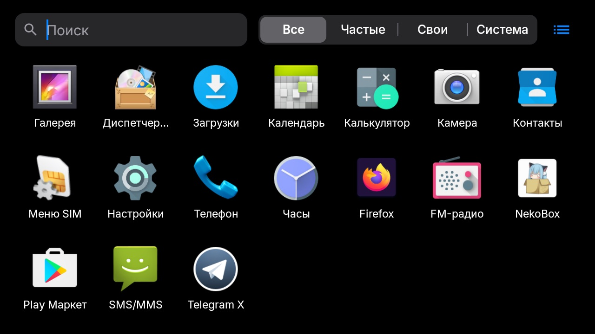 | 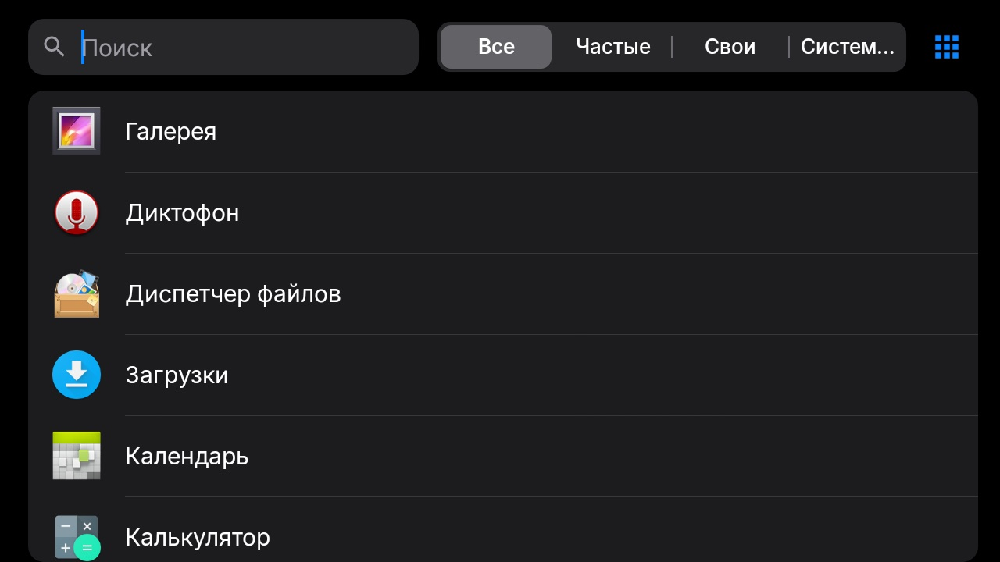 |

### Настройки
Свайп вправо с карточек. Устроены как настройки iPad: разделы слева, содержимое справа,
вложенные страницы с кнопкой «‹ Назад».

| | |
|---|---|
| 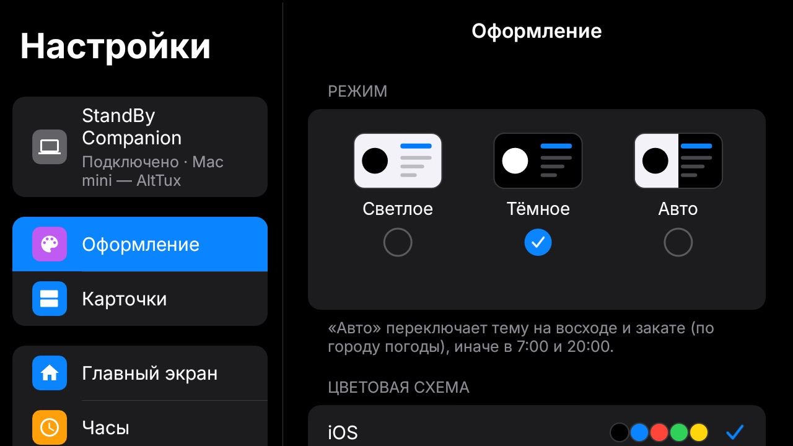 | 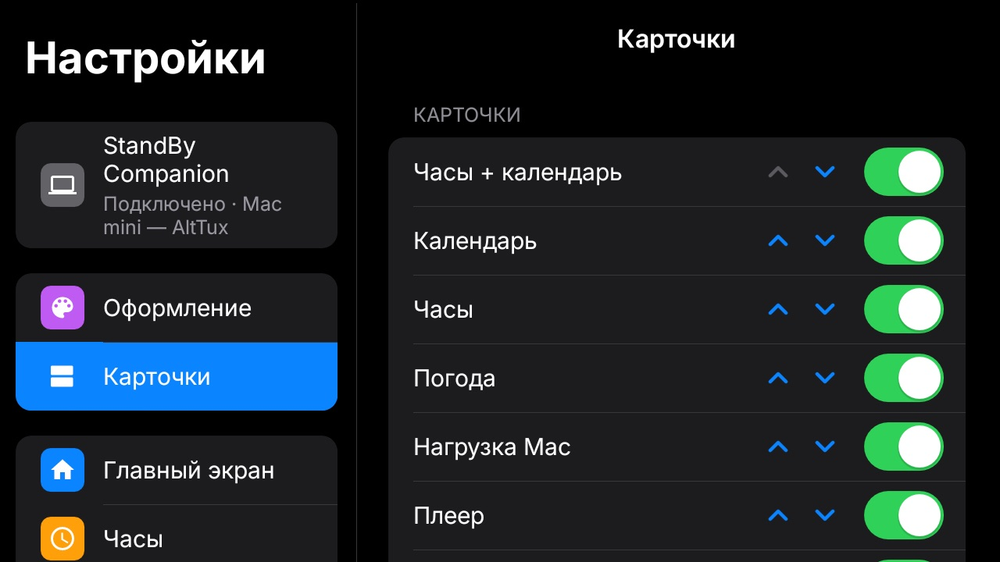 |
| 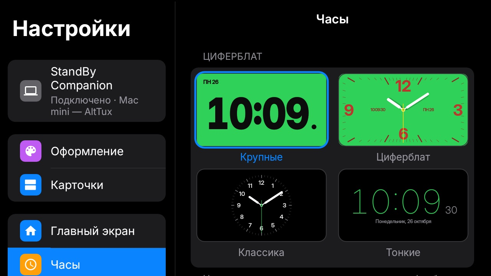 | 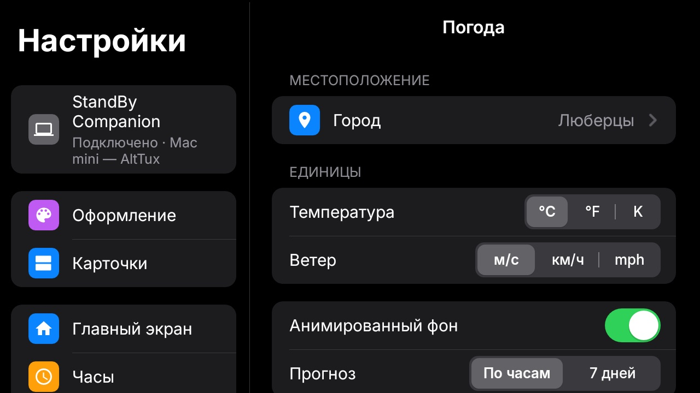 |

| Раздел | Что настраивается |
|---|---|
| Оформление | светлая / тёмная / авто тема, цветовая схема, акцентный цвет, свои темы |
| Карточки | видимость и порядок карточек, «по кругу», возврат к первой карточке после 1/5/15 мин бездействия |
| Главный экран | аналоговые или цифровые часы, часы справа, секунды, акцент |
| Часы | циферблат, цвет, формат 12/24/авто, секунды, дата |
| Календарь | первый день недели, номера недель, приглушение выходных |
| Погода | город (поиск), единицы температуры и ветра, анимированный фон, почасовой или недельный прогноз, «Обновить сейчас» |
| Приложения | сетка / список, сортировка, скрытые приложения, сброс статистики запусков |
| Нагрузка Mac | длина истории графиков |
| Плеер | фон по цвету обложки |
| Созвоны | визуализатор вкл/выкл, стиль «столбики» или «волна» |
| Touch Bar | число строк: 2, 3 или 4 |
| Экран и питание | не выключать экран, удерживать экран и в других приложениях, яркость, сдвиг пикселей, скрытие системных панелей |
| Ночной режим | выкл / по расписанию / по датчику освещённости, снижение яркости |
| Компаньон для Mac | состояние, TCP-порт, перезапуск сервера, журнал лаунчера |
| Об устройстве | версия, выбор лаунчера по умолчанию, настройки Android |

### Ночной режим
Весь интерфейс становится тусклым красным, как StandBy ночью, и яркость падает до минимума.
Включается по расписанию (по умолчанию 22:00–07:00) или по датчику освещённости, если он есть.

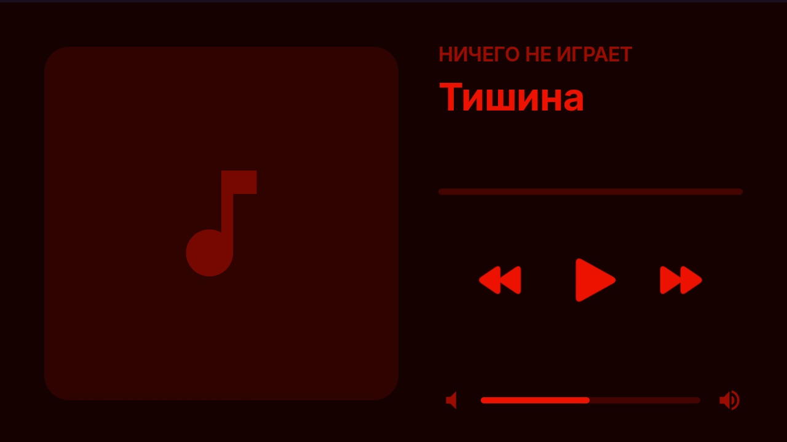

### Экран и питание
- Пока лаунчер на экране, он держит флаг `FLAG_KEEP_SCREEN_ON`.
- «И в других приложениях» запускает сервис с wake lock, и экран не гаснет нигде.
- Чтобы телефон не засыпал на зарядке даже без лаунчера: компаньон → Settings → **Keep Awake While Charging**.
  Это то же самое, что `adb shell settings put global stay_on_while_plugged_in 7`.
- Сдвиг пикселей раз в минуту немного смещает изображение, чтобы экран не выгорал.

## Оформление и свои темы

Встроено 8 схем, у каждой есть светлый и тёмный вариант: iOS, Catppuccin, Gruvbox, Nord, Dracula, Solarized,
Tokyo Night, Rosé Pine. В режиме «Авто» тема переключается на восходе и закате для города из погоды,
без города — в 7:00 и 20:00. Интерфейс использует шрифт Inter, ближайший открытый аналог SF Pro.

| Catppuccin | Своя тема «Sunset» |
|---|---|
| 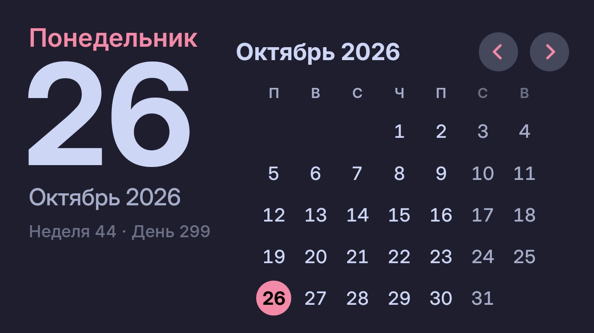 | 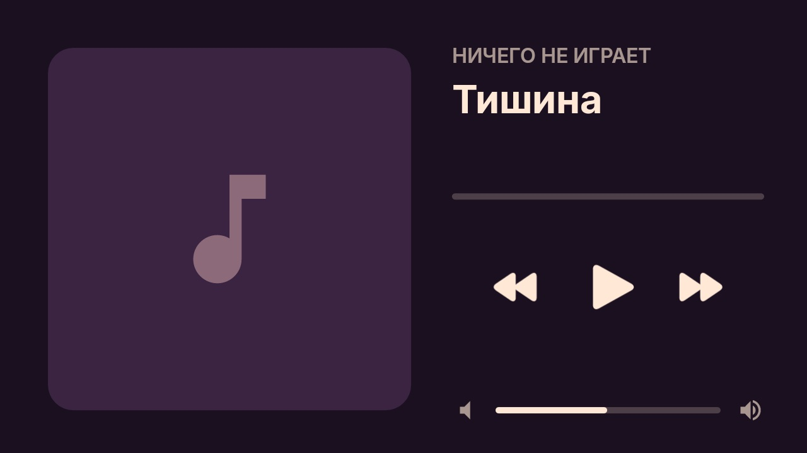 |

### Формат темы
Тема — JSON с палитрой `light` и/или `dark`. Если задана одна палитра, она используется в обоих режимах;
недостающие цвета берутся из схемы iOS. Цвета: `#RRGGBB` или `#AARRGGBB`. Полный пример — [themes/sunset.json](themes/sunset.json).

```json
{
  "id": "sunset",
  "name": "Sunset",
  "light": { "background": "#FFF4EC", "accent": "#F25C54" },
  "dark":  { "background": "#1B1020", "surface": "#2A1A30", "text": "#FFE8D6", "accent": "#FF7B54" }
}
```

| Ключ | Назначение |
|---|---|
| `background` | фон карточек и экранов |
| `surface`, `surface2` | ячейки настроек, плитки, кнопки |
| `separator` | разделители |
| `text`, `text2`, `text3` | основной, вторичный и третичный текст |
| `accent` | акцент (выделения, переключатели) |
| `red` `orange` `yellow` `green` `teal` `blue` `purple` `pink` | цвета акцентов, часов, графиков и погоды |

Добавить тему можно тремя способами:
- компаньон → **Send Theme…** → выбрать `.json`: тема сразу появится в списке;
- `adb push themes/sunset.json /sdcard/Android/data/dev.standby/files/themes/`, затем Оформление → «Перезагрузить темы»;
- Оформление → «Создать из текущей схемы»: в той же папке появится файл, который можно отредактировать.

## Компаньон для macOS

Компаньон работает только в строке меню, без иконки в Dock. Пункты меню:

| Пункт | Что делает |
|---|---|
| статус | «Connected to Jinga Storm · USB/Wi-Fi», «launcher not responding», «No Android device» |
| Check Connection | пошаговая проверка: adb → устройство → лаунчер установлен → лаунчер отвечает (с задержкой в мс) |
| Open StandBy on Phone | запускает лаунчер на телефоне |
| Send Theme… | отправляет JSON-тему на телефон |
| Settings… | окно настроек |
| Logs… | журналы компаньона и лаунчера |

| Настройки | Журналы |
|---|---|
| 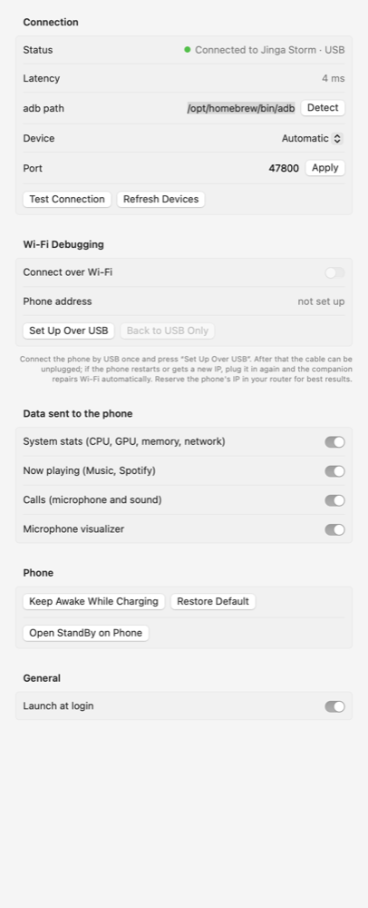 | 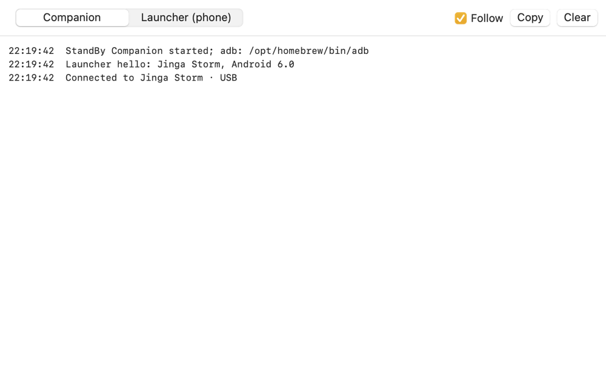 |

**Настройки:** состояние и задержка, путь к adb, выбор устройства (если подключено несколько), порт (47800),
проверка подключения, Wi-Fi-отладка, какие данные отправлять (нагрузка, плеер, созвоны, визуализатор),
«не гасить экран телефона при зарядке», открыть лаунчер, автозапуск при входе.

**Журналы:** вкладка «Companion» — лог компаньона, он же пишется в `~/Library/Logs/StandByCompanion.log`.
Вкладка «Launcher (phone)» — `adb logcat -s StandBy` с телефона, обновляется каждые 2 секунды.

**Аргументы запуска** (для отладки и автоматизации):
```bash
open "/Applications/StandBy Companion.app" --args --settings --logs                  # сразу открыть окна
open "/Applications/StandBy Companion.app" --args --settings --snapshot ~/Desktop    # сохранить окна в PNG
```

## Подключение по Wi-Fi

1. Подключите телефон кабелем. Mac и телефон должны быть в одной сети.
2. Компаньон → Settings → **Wi-Fi Debugging → Set Up Over USB**. Компаньон узнает IP телефона, выполнит
   `adb tcpip 5555` и `adb connect <IP>:5555` и включит «Connect over Wi-Fi».
   Если macOS спросит про доступ к локальной сети — разрешите.
3. Кабель можно отключить: в меню будет «Connected to … · Wi-Fi».

Как ведёт себя подключение:
- телефон не отвечает больше 9 секунд — компаньон разрывает сессию и, если кабель подключён, переходит на USB;
- Wi-Fi вернулся — компаньон проверяет это раз в 9 секунд и сам переходит обратно;
- после перезагрузки телефона режим adb по TCP сбрасывается. Подключите кабель, и компаньон включит его снова.
  `adb tcpip` перезапускает adbd и рвёт USB, поэтому компаньон выполняет его, только если TCP-режим действительно
  выключен, а неудачные попытки повторяет с нарастающей паузой: от 1 до 10 минут;
- если IP телефона поменялся, при подключённом кабеле компаньон найдёт новый;
- если adb-сервер запущен другим приложением и macOS не пускает его в локальную сеть («No route to host»),
  компаньон перезапускает adb-сервер от своего имени, не чаще раза в 10 минут;
- раз в минуту в лог пишется качество связи: `Link Wi-Fi: ping avg 63 ms, max 498 ms, lost 0`;
- «Back to USB Only» выключает Wi-Fi-отладку (`adb usb`).

Пока лаунчер на экране, он держит Wi-Fi телефона в режиме высокой производительности (WifiLock), чтобы связь
не засыпала. Закрепите IP телефона в роутере, чтобы адрес не менялся.

Вручную:
```bash
adb tcpip 5555
adb connect 192.168.1.150:5555   # IP телефона: adb shell ip addr show wlan0
```

> В режиме adb по TCP к телефону может подключиться любой компьютер в вашей сети.
> Включайте его только в доверенной домашней сети.

## Как всё устроено

```
 ┌──────────────── Mac ────────────────┐                ┌──────────── Android 6 ────────────┐
 │ StandBy Companion (строка меню)     │                │ StandBy launcher                  │
 │  SystemStats  — CPU/GPU/RAM/сеть    │                │  Mac.kt — TCP-сервер 127.0.0.1    │
 │  MediaController — AppleScript      │   adb forward  │          :47800, JSON-строки      │
 │  CallMonitor / Audio — CoreAudio    │ ─────────────▶ │  карточки ← данные компаньона     │
 │  Visualizer — AVAudioEngine + FFT   │  USB или Wi-Fi │  команды (пауза, mute) → Mac      │
 │  Hub — таймеры, команды, HTTP-прокси│ ◀───────────── │  погода: open-meteo (или через Mac)│
 │  Connection — adb, переподключение  │                │                                   │
 └─────────────────────────────────────┘                └───────────────────────────────────┘
```

**Лаунчер**
- Без AndroidX и Compose: только `View` и `Canvas`, поэтому APK весит около 450 КБ и работает на слабом
  armv7-телефоне. Карточки рисуются вручную; анимации идут только на видимой карточке и ограничены 15–30 кадрами в секунду.
- `Navigator` — три горизонтальные панели (настройки · карточки · приложения). `CardPager` — вертикальная
  зацикленная стопка карточек с индикатором и долгим нажатием.
- `Themes` / `Palette` — встроенные схемы и JSON-темы из `Android/data/dev.standby/files/themes`.
  При смене темы дерево view пересоздаётся, а навигация, раздел и прокрутка настроек сохраняются.
- `Mac` — сервер для компаньона на `127.0.0.1:47800`: снаружи телефона он недоступен, только через `adb forward`.
- `WeatherRepo` + `Http` — open-meteo с кешем. Android 6 не доверяет новым корням Let's Encrypt, поэтому порядок такой:
  HTTPS со встроенными корнями ISRG X1/X2 → прокси через Mac (только хосты open-meteo) → HTTP.
  После неудачного прямого запроса лаунчер 30 минут ходит сразу через Mac.
- Ночной режим — аппаратный слой с `ColorMatrix` (яркость в красный канал) поверх всего интерфейса.

**Компаньон**
- `Connection` — `adb forward`, TCP через Network.framework, `hello`/`ping` каждые 3 с,
  разрыв при 9 с тишины, выбор и восстановление транспорта USB/Wi-Fi.
- `SystemStats` — `host_processor_info`, IOAccelerator `PerformanceStatistics`, `host_statistics64`, `getifaddrs`, IOPowerSources.
- `MediaController` — AppleScript к Music и Spotify; обложка уходит на телефон в JPEG 320×320 один раз на трек.
- `CallMonitor` / `Audio` — процессы, которые пишут с микрофона (`kAudioHardwarePropertyProcessObjectList`, macOS 14.2+);
  mute или громкость устройств по умолчанию через CoreAudio.
- `Visualizer` — микрофон через AVAudioEngine, 1024-точечное FFT (vDSP) → 24 полосы, 20 раз в секунду.
  Переживает переключение Bluetooth-профиля.

## Протокол лаунчер ⇄ компаньон

Транспорт: `adb forward tcp:47800 tcp:47800` → `127.0.0.1:47800`. Одно JSON-сообщение на строку, в обе стороны.
Лаунчер держит одного клиента: новое подключение закрывает предыдущее.

| Mac → телефон | Поля |
|---|---|
| `hello` | `name` |
| `stats` | `cpu`, `gpu`, `gpuName`, `cores`, `load[]`, `memUsed`, `memTotal`, `swapUsed`, `netRx`, `netTx` (байт/с), `battery`, `charging`, `diskFree`, `diskTotal`, `uptime`, `thermal` |
| `media` | `available`, `app`, `title`, `artist`, `album`, `duration`, `position` (с), `playing`, `volume` (0…1), `artworkId` |
| `artwork` | `id`, `data` (JPEG в base64) |
| `call` | `active`, `app`, `since` (мс), `micMuted`, `outputMuted`, `input`, `output` |
| `viz` | `bands[24]` (0…1), 20 раз в секунду, только по подписке |
| `touchbar.status` | `error` — почему Touch Bar не транслируется (пусто — всё в порядке) |
| `touchbar` | `data` (PNG в base64), `w`, `h` (px), `pw`, `ph` (pt), `app`, `input`; только по подписке, при изменениях, до 15 кадров/с |
| `theme` | `theme` (объект темы), `file` |
| `http` | ответ на прокси-запрос: `id`, `status`, `body` |
| `ping` | `id` → телефон отвечает `pong` с тем же `id` |

| Телефон → Mac | Поля |
|---|---|
| `hello` | `app`, `version`, `device`, `android` |
| `cmd` | `action`: `media.playpause`, `media.next`, `media.prev`, `media.seek` (с), `volume.set` (0…1), `call.mic` (bool), `call.output` (bool); `value` |
| `subscribe` | `viz` и/или `touchbar`: true/false — открыта ли соответствующая карточка; ключи независимы |
| `touchbar.touch` | `phase` (`down`/`move`/`up`), `x`, `y` — точки Touch Bar, начало слева внизу |
| `http` | `id`, `url` — прокси-запрос погоды |
| `ack` | `what`, `ok`, `file`/`error` — подтверждение установки темы |

Проверить протокол без компаньона:
```bash
adb forward tcp:47800 tcp:47800
printf '{"type":"hello","name":"test"}\n{"type":"ping","id":1}\n' | nc 127.0.0.1 47800
```

## Сборка из исходников

**Лаунчер** — JDK 17+ (подходит JBR из Android Studio) и Android SDK (platform 37, build-tools 36):
```bash
cd android
export JAVA_HOME="/Applications/Android Studio.app/Contents/jbr/Contents/Home"
./gradlew assembleRelease     # → app/build/outputs/apk/release/app-release.apk
adb install -r app/build/outputs/apk/release/app-release.apk
```
Release и debug подписываются одним ключом `android/keystore/standby.jks` (пароль `standby`), поэтому
сборки ставятся поверх друг друга без потери настроек. Это ключ для личного использования; для публикации замените его.

**Компаньон** — Xcode Command Line Tools, Swift 5.9+:
```bash
cd companion
./build.sh                    # → build/StandBy Companion.app и dist/StandBy-Companion-macOS.zip
```
С полным Xcode скрипт соберёт универсальный бинарник arm64 + x86_64, иначе — под текущую архитектуру.

## Решение проблем

| Симптом | Что делать |
|---|---|
| Компаньон: «adb not found» | `brew install android-platform-tools` или укажите путь в Settings → adb path |
| «No Android device» | проверьте кабель, «Отладку по USB» и запрос «Разрешить отладку» на телефоне |
| «launcher not responding» | откройте лаунчер (меню → Open StandBy on Phone); порт в настройках лаунчера и компаньона должен совпадать |
| Плеер «Ничего не играет» при играющей музыке | разрешите компаньону «Автоматизацию» для Music или Spotify (Конфиденциальность и безопасность → Автоматизация) |
| Touch Bar: вечное «Ожидание» или «Touch Bar недоступен» | компаньон сам перезапускает ControlStrip (если он завис после аварийного выхода); вручную: `killall ControlStrip` |
| Touch Bar: нажатия не работают | включите StandBy Companion в «Универсальном доступе»; после пересборки компаньона выключите и включите снова |
| Визуализатор не двигается | разрешите микрофон; проверьте, что микрофон не выключен кнопкой на карточке |
| Wi-Fi: «No route to host» | разрешите компаньону «Локальную сеть»; компаньон сам перезапустит adb-сервер; телефон и Mac должны быть в одной сети |
| Погода «недоступна» | без интернета на телефоне погода идёт через компаньон — подключите его; «Обновить сейчас» в Настройках → Погода |
| Нажатие «Домой» открывает другой лаунчер | Настройки → Об устройстве → «Выбрать лаунчер по умолчанию» |

Логи: компаньон → Logs… или `~/Library/Logs/StandByCompanion.log`; лаунчер — `adb logcat -s StandBy`
или Настройки → Компаньон для Mac → Журнал лаунчера.

## Ограничения
- **Плеер** поддерживает только Apple Music и Spotify (AppleScript). С macOS 15.4 Apple закрыла сторонним
  приложениям системный «Сейчас играет» (MediaRemote), поэтому браузеры и другие плееры не видны.
  Без этих плееров кнопки эмулируют медиаклавиши, для этого нужен «Универсальный доступ».
- **Визуализатор** показывает микрофон Mac. Пока открыта карточка «Созвоны», Bluetooth-наушники работают
  в режиме гарнитуры и музыка звучит хуже. В коде есть источник системного звука (`SystemAudioSource`, Core Audio
  process tap, macOS 14.2+), сейчас он отключён в `Visualizer.update`.
- **Определение созвона** точное на macOS 14.2+; на более старых macOS созвоном считается любое использование микрофона.
- Кнопки «Выкл. микрофон / звук» действуют на устройства по умолчанию, то есть на всю систему. Если у микрофона
  нет аппаратного mute, громкость ставится в 0 и потом восстанавливается.
- Готовый компаньон собран только для Apple Silicon.
- **Touch Bar** работает через приватный API macOS (проверено на 15.8.1); в новых версиях он может исчезнуть.
- Задержка по Wi-Fi на тестовом телефоне — в среднем 60–70 мс с пиками до 0,5 с (2,4 ГГц): для часов и графиков
  этого достаточно, по USB — 4–5 мс.

## Лицензии
Шрифт Inter © The Inter Project Authors, SIL Open Font License 1.1 (`android/INTER_LICENSE.txt`).
Погода — Open-Meteo.com, CC BY 4.0. Иконки интерфейса основаны на Material Icons (Apache 2.0).
