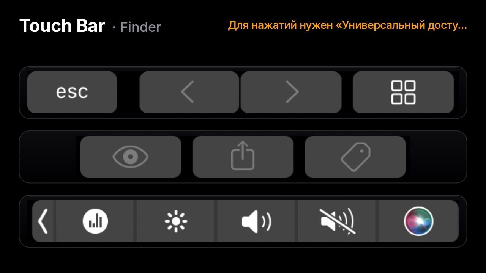
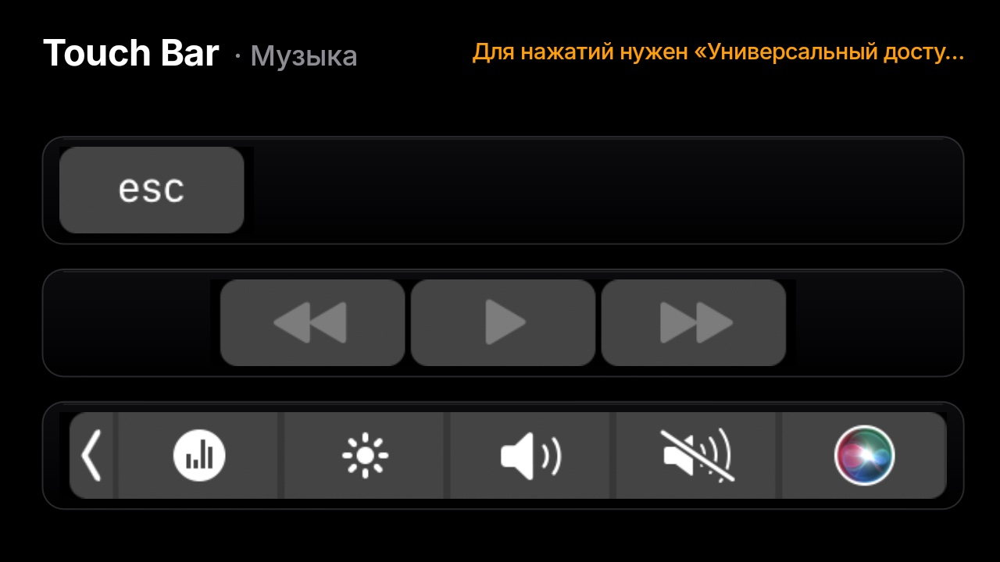
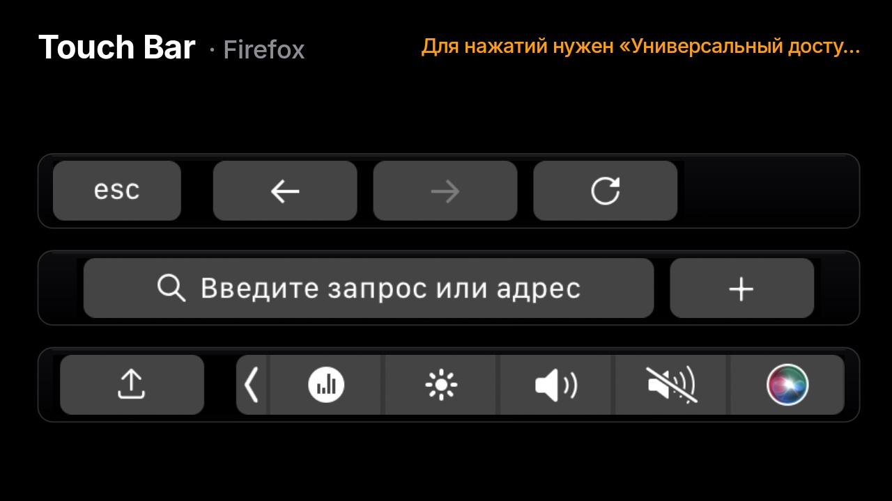
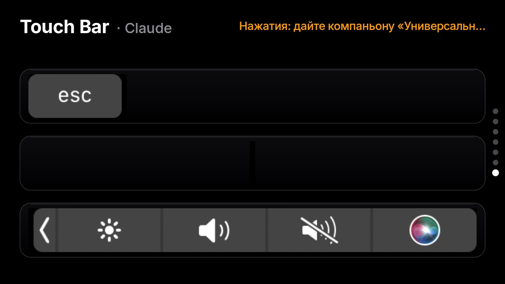
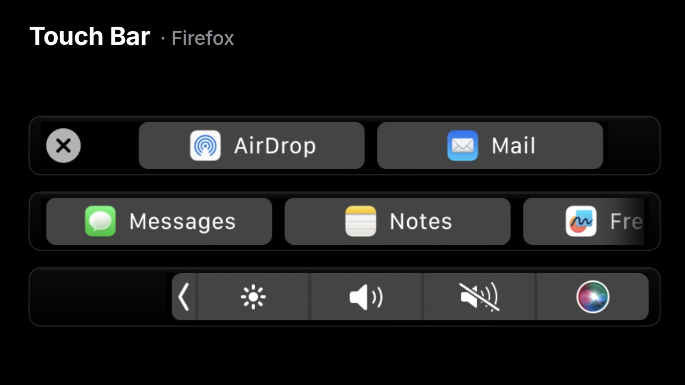
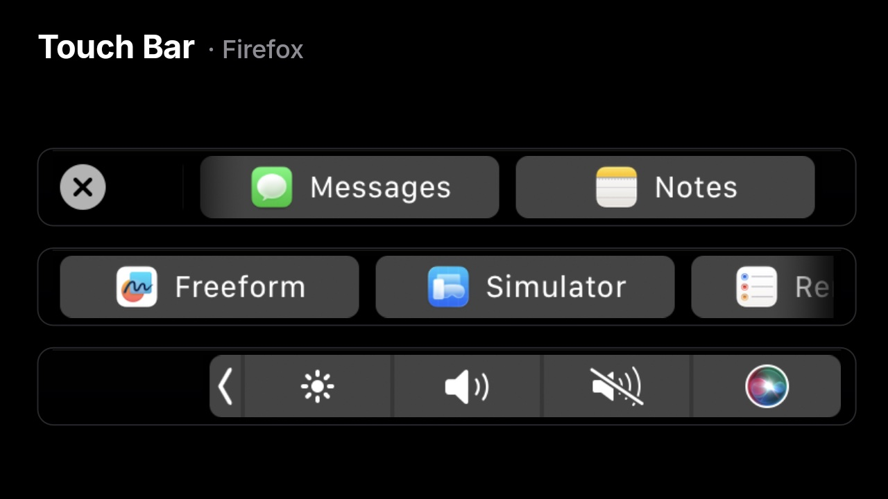

# Адаптация эмулятора Touch Bar под лаунчер StandBy

Задача: показать на телефоне **настоящий** Touch Bar macOS — системный, как в симуляторе Xcode и в
[touch-bar-simulator](https://github.com/sindresorhus/touch-bar-simulator), а не самодельный —
и разложить его в несколько строк, чтобы полоса 36:1 органично выглядела на экране 16:9.
Почему механизм работает на macOS 15 — в [RESEARCH.md](RESEARCH.md).

| Finder | Music |
|---|---|
|  |  |
| **Firefox** | |
|  | |

## Схема

```
Mac (StandBy Companion)                                  Телефон (лаунчер)
DFRSetStatus(2) ─▶ виртуальный Touch Bar macOS
SLSDFRDisplayStreamCreate ─▶ IOSurface 2170×60
   └─ PNG, ≤15 кадров/с, только изменившиеся ── touchbar ──▶ TouchBarCard: строки, глянцевые полосы
DFRFoundationPostEventWithMouseActivity ◀── touchbar.touch ── касания (down / move / up)
```

## Компаньон: `companion/Sources/StandByCompanion/TouchBar.swift`

Ядро — `TouchBarView.swift` из оригинала: те же пять приватных функций, та же логика `start/stop`
(виртуальный Touch Bar включается, только если нет физического, и при остановке возвращается исходный статус).
Изменения:

| Оригинал | StandBy |
|---|---|
| линковка через bridging header | `dlopen`/`dlsym`: в SDK нет заглушек для приватных фреймворков |
| `stream.start()` / `stop()` | `CGDisplayStreamStart`/`Stop` через `dlsym`: в SDK macOS 15 методы недоступны |
| IOSurface → `layer.contents` | IOSurface → `CIImage` → PNG → base64 → телефон |
| каждый кадр | не чаще 15 кадров/с, только последний кадр, одинаковые кадры не отправляются |
| `NSEvent` мыши из окна | касания с телефона → `leftMouseDown/Dragged/Up` |
| запрос Accessibility при старте | запрос при первом касании; в кадре флаг `input`, телефон показывает подсказку |

**Устойчивость.** Если `CGDisplayStreamStart` возвращает ошибку (обычно `1000` из-за зависшего ControlStrip,
см. RESEARCH.md, п. 4), компаньон сам перезапускает ControlStrip (не чаще раза в минуту) и через 3 с пробует снова;
другие ошибки повторяются раз в 30 с, а не каждую секунду. Статус Touch Bar восстанавливается и при SIGTERM, SIGINT
и SIGHUP: `kill` и Ctrl-C не вызывают `applicationWillTerminate`. Если поток не работает, телефон получает
`touchbar.status` с причиной и показывает её вместо «Ожидания».

Поток работает только пока карточка Touch Bar открыта на телефоне (подписка `subscribe {touchbar}`)
и включена настройка «Touch Bar emulator». При выходе из компаньона статус Touch Bar восстанавливается
(`applicationWillTerminate`). Вместе с кадром передаётся название активного приложения.

Трафик: PNG чёрной полосы 2170×60 занимает 25–40 КБ. Кадры идут только при изменениях
(CGDisplayStream сам молчит, пока Touch Bar не меняется), в анимации — до 15 в секунду. Для USB и Wi-Fi это немного.

## Протокол

| Направление | Сообщение | Поля |
|---|---|---|
| телефон → Mac | `subscribe` | `touchbar: true/false` (ключи подписки теперь независимы: `viz` и `touchbar`) |
| Mac → телефон | `touchbar` | `data` (PNG, base64), `w`, `h` (px), `pw`, `ph` (pt), `app`, `input` (есть ли Accessibility) |
| Mac → телефон | `touchbar.status` | `error` — почему кадров нет (пусто, если всё в порядке) |
| телефон → Mac | `touchbar.touch` | `phase`: `down`/`move`/`up`, `x`, `y` — точки Touch Bar, начало слева внизу |

## Лаунчер: `android/app/src/main/java/dev/standby/cards/TouchBarCard.kt`

### Раскладка в несколько строк
Резать полосу на равные части нельзя: кнопки разрежутся. Порядок такой:

1. **Пустые столбцы.** При декодировании кадра (`Mac.decodeTouchBar`, в фоновом потоке) для каждого столбца
   пикселей отмечается, состоит ли он только из чёрного фона (каждая 3-я строка, сумма каналов ≤ 60).
2. **Группы кнопок.** Промежутки на реальных кадрах: внутри группы 2–4 px (⏪▶⏩, ‹ ›),
   между кнопками 16 px, между разделами (esc / приложение / Control Strip) 32 px и больше.
   Группа — участок, внутри которого нет промежутка от 12 px.
3. **Строки.** Группы идут подряд и распределяются по 2–4 строкам (настройка, по умолчанию 3) так,
   чтобы самая широкая строка была минимальной: линейное разбиение динамическим программированием.
   Группа никогда не разрывается; если групп меньше, чем строк, строк меньше.
4. **Масштаб** у всех строк общий: он подбирается по самой широкой строке и по высоте экрана,
   поэтому все кнопки одного размера, как на реальной полосе.
5. **Выравнивание как у железа:** первая строка прижата влево (там `esc`), последняя вправо (Control Strip),
   средние по центру.
6. **Вид:** каждая строка — глянцевая чёрная полоска со скруглением, тонкой рамкой и бликом сверху;
   на светлой теме это выглядит как Touch Bar на серебристом MacBook. В заголовке — «Touch Bar · приложение»,
   справа подсказка, если на Mac нет «Универсального доступа».

До и после исправлений: сначала полоса резалась на равные части, и это давало пустые строки
и разрезанные группы (⏪▶ | ⏩). Теперь строки собираются из целых групп.



### Касания
- Координата на экране → строка → столбец исходного кадра (`srcFrom + (x − left) / scale`) → точки Touch Bar
  (`× pw / w`, по Y отражение, потому что начало слева внизу).
- **Листание Touch Bar.** Касание полосы сразу забирает жест у навигатора и пейджера
  (`requestDisallowInterceptTouchEvent`), поэтому горизонтальный свайп по полосе листает списки Touch Bar
  (scrubber: «Поделиться», эмодзи, подсказки ввода), а не переключает панели лаунчера. При перетаскивании
  координата не ограничена своей строкой и продолжается по всей полосе, так что список, разнесённый на две строки,
  долистывается до конца. Чтобы уйти к приложениям или настройкам, свайпайте вне полос (по заголовку или промежуткам).

  | До листания | После свайпа влево |
  |---|---|
  |  |  |

- Пейджер отменяет своё долгое нажатие (открыть настройки карточки), когда дочерний элемент забирает жест.
  Иначе удержание или медленное листание Touch Bar открывало бы настройки.
- Чтобы не мешать вертикальным свайпам между карточками, касание передаётся не сразу:
  - отпускание без движения — тап (`down`, через 60 мс `up`: одновременные press и release Touch Bar игнорирует);
  - горизонтальное движение — перетаскивание слайдеров яркости и громкости
    (`down`, `move` не чаще раза в 30 мс, `up`; перехват пейджером запрещён);
  - удержание дольше 180 мс — долгое нажатие (например, раскрыть Control Strip);
  - вертикальное движение до этого — жест возвращается пейджеру и листает карточки, в Touch Bar ничего не уходит.

### Настройки
Новый раздел «Touch Bar»: число строк 2/3/4 и пояснение. В компаньоне — переключатель
«Touch Bar emulator» в Settings → Data sent to the phone.

## Проверка на устройстве (Jinga Storm, подключение по Wi-Fi)

| Проверка | Результат |
|---|---|
| Карточка появляется после «Созвонов», поток запускается при открытии и останавливается при уходе | ✓ (`Touch Bar emulator started/stopped` в логе) |
| Нет приложения с Touch Bar | ✓ 2 строки: `esc` / Control Strip |
| Finder | ✓ `esc ‹ › ▦` / 👁 ⇪ 🏷 / Control Strip |
| Music | ✓ `esc` / ⏪ ▶ ⏩ одной группой / Control Strip с «Сейчас играет» |
| Firefox | ✓ навигация / адресная строка и «+» / «Поделиться» и Control Strip |
| Смена активного приложения на Mac | ✓ раскладка перестраивается сама (Finder → Music → Firefox) |
| Зависший ControlStrip (`kill -9` компаньона, затем запуск) | ✓ компаньон перезапустил ControlStrip, Touch Bar пошёл через 3 с |
| Касания доходят до компаньона | ✓ (`touchbar.touch` в логе) |
| Касания срабатывают в macOS (с «Универсальным доступом») | ✓ «Поделиться» в Firefox открывает список |
| Листание длинного списка свайпом по полосе | ✓ AirDrop, Mail → … → Simulator, Reminders, More… |
| Вертикальный свайп, начатый на полосе | ✓ переключает карточку |
| Горизонтальный свайп по заголовку | ✓ открывает список приложений |

## Ограничения
- Приватный API: может пропасть в любом обновлении macOS (проверено на 15.8.1).
- Для нажатий нужен «Универсальный доступ»; у ad-hoc-сборки разрешение сбрасывается после каждой пересборки.
- Пока карточка открыта, macOS считает, что у Mac есть Touch Bar. На Mac без него это незаметно,
  а при закрытии карточки статус возвращается.
